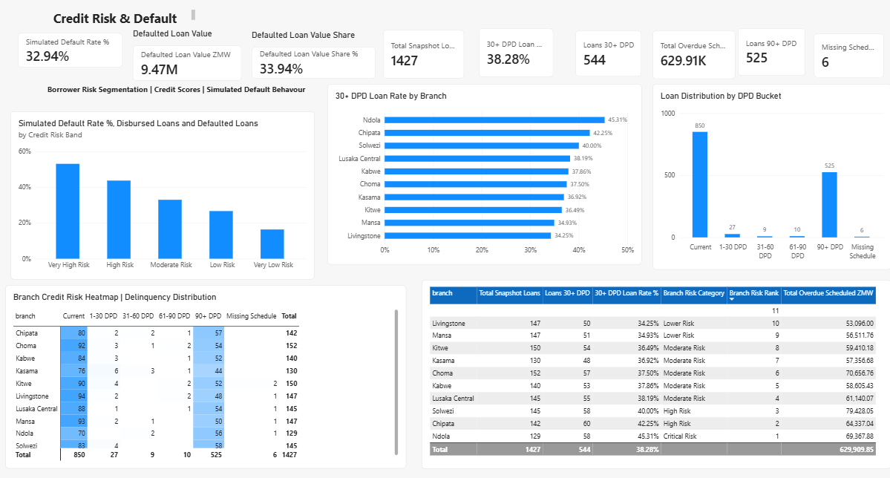
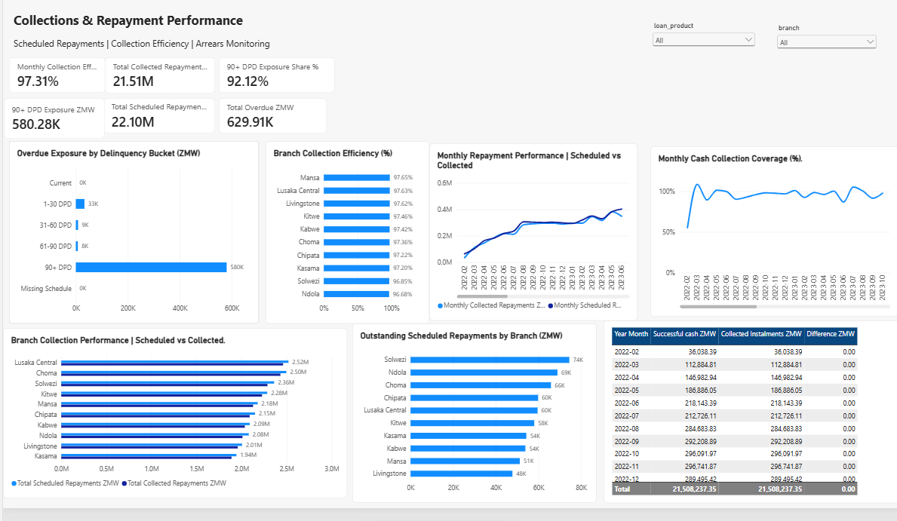
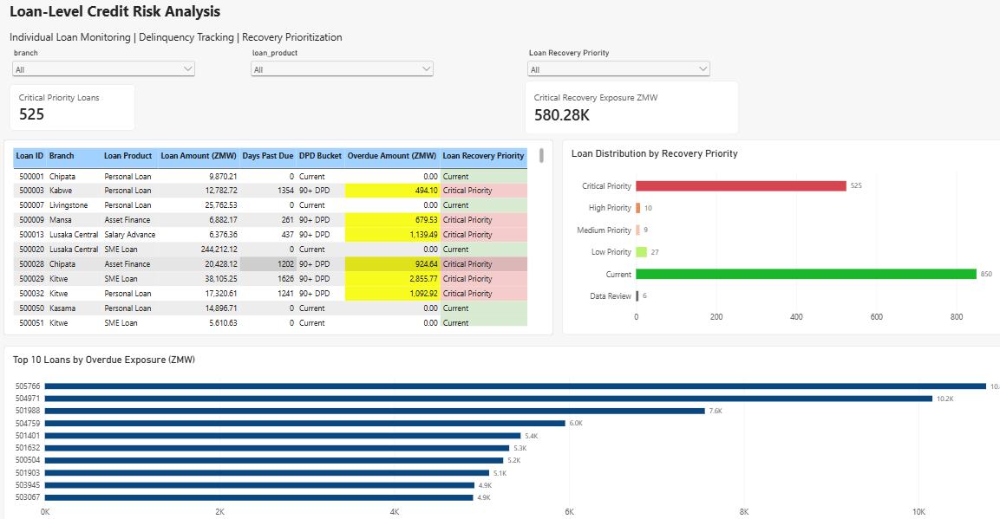

# Credit Risk Analytics | MySQL & Power BI

## Project Overview

An end-to-end Credit Risk Analytics project developed using **MySQL, Microsoft Power BI, Power Query and DAX** to demonstrate how financial institutions can monitor loan portfolios, evaluate borrower risk, identify delinquency patterns, analyse repayment performance and prioritize recovery activities.

The project uses a **synthetic banking dataset** for analytical demonstration and portfolio development.

## Business Objectives

- Monitor loan portfolio performance and credit exposure.
- Identify borrowers and loans exhibiting elevated credit risk.
- Analyse simulated loan defaults and delinquency patterns.
- Evaluate collection efficiency and repayment performance.
- Compare branch-level credit risk and recovery exposure.
- Prioritize overdue loans for collection and recovery activities.
- Provide interactive dashboards to support credit management decisions.

## Technology Stack

| Technology | Application |
|---|---|
| MySQL | Data storage, transformation and SQL analysis |
| Power BI | Interactive dashboards and reporting |
| DAX | Financial KPIs and analytical measures |
| Power Query | Data preparation and transformation |
| GitHub | Documentation and project version control |

## Data Model

The analytical model includes the following tables:

**Fact Tables**
- FactLoans
- FactPayments
- FactPaymentSchedule
- FactDelinquencySnapshot

**Dimension Tables**
- DimCustomer
- DimBranch
- DimDate
- DimDPDBucket
- DimRecoveryPriority

The model uses relationships between loan, customer, branch, repayment and delinquency data to support interactive analysis.

## Dashboard Pages

### 1. Credit Risk Analysis
Provides an overview of the loan portfolio, lending activity and key credit risk indicators.

### 2. Credit Risk & Default Analysis
Examines borrower credit risk segmentation, simulated default behaviour, delinquency distribution and branch-level risk rankings.

### 3. Collections & Repayment Performance
Analyses scheduled repayments, collected amounts, collection efficiency, overdue exposure and branch repayment performance.

### 4. Loan-Level Credit Risk Analysis
Provides individual loan monitoring, days-past-due tracking, recovery priority classification and identification of high-exposure overdue loans.

## Key Portfolio Findings

The synthetic dataset produced the following analytical results:

| Indicator | Result |
|---|---:|
| Total Loan Records | 1,427 |
| Loans 30+ Days Past Due | 544 |
| 30+ DPD Loan Rate | 38.28% |
| Loans 90+ Days Past Due | 525 |
| Total Overdue Exposure | ZMW 629.91K |
| 90+ DPD Exposure | ZMW 580.28K |
| Total Scheduled Repayments | ZMW 22.10M |
| Total Collected Repayments | ZMW 21.51M |
| Collection Efficiency | 97.31% |
| Simulated Default Rate | 32.94% |

**Analytical observations:**

- A significant proportion of the simulated portfolio is concentrated in the 90+ DPD category.
- Delinquency and overdue exposure vary across branches, supporting targeted portfolio monitoring.
- Recovery prioritization enables credit teams to identify loans requiring immediate attention.
- The collection dashboard demonstrates how repayment performance can be monitored across branches and reporting periods.

These findings are illustrative and should not be interpreted as actual banking performance.

## Project Screenshots

### Credit Risk & Default Analysis

### Collections & Repayment Performance

### Loan-Level Credit Risk Analysis

## Project Limitations

- The dataset is synthetic and does not contain actual customer or banking records.
- Default rates represent simulated behaviour rather than validated probability-of-default estimates.
- Collection performance reflects the structure and assumptions of the demonstration dataset.
- Production implementation would require additional data quality controls, governance, security, validation and regulatory alignment.

## Future Enhancements

- Probability of Default (PD) modelling.
- Loss Given Default (LGD) and Expected Credit Loss (ECL) analysis.
- IFRS 9 credit impairment reporting.
- Loan vintage and cohort analysis.
- Automated data refresh and monitoring.
- Real-world validation using appropriately authorized, anonymized banking data.

## Project Author

**Sandford Malulu**

Data Analyst | Business Intelligence | Power BI | SQL | Financial Analytics

MBA (Finance) – Distinction

[GitHub Profile](https://github.com/SandfordMalulu)

---

*Portfolio project demonstrating practical applications of business intelligence and credit risk analytics in financial services.*
